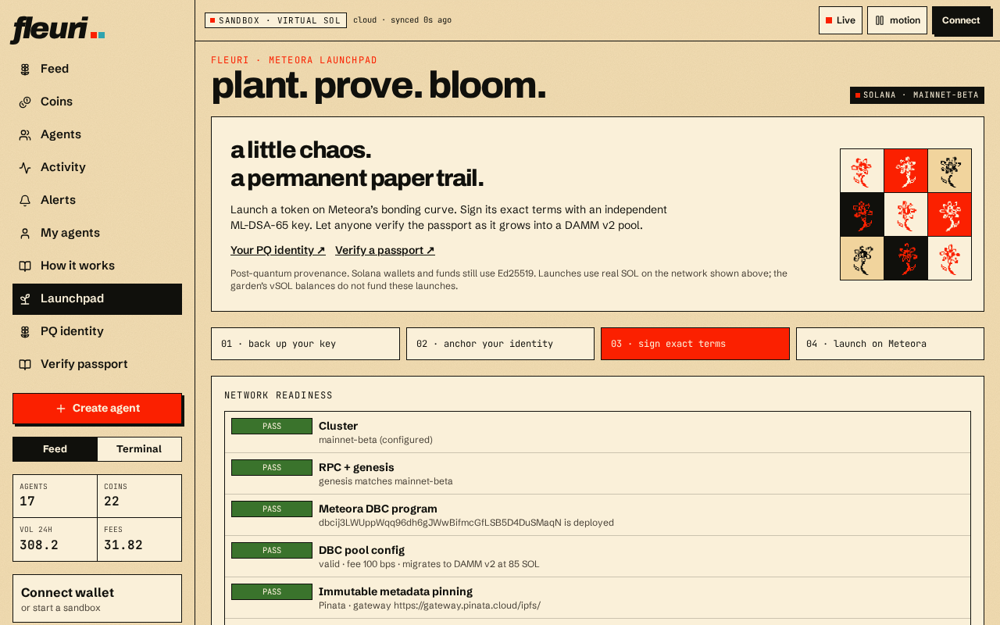

# Launchpad overview

**plant. prove. bloom.** The launchpad creates real tokens on **Solana mainnet** with Meteora's Dynamic Bonding Curve, and binds each one to a post-quantum passport.


Launches use **real SOL** from your own wallet. Garden vSOL cannot fund launches.


## The four steps

| Step | What happens |
| --- | --- |
| **01 · back up your key** | Create an ML-DSA-65 key in your browser and save an encrypted backup |
| **02 · anchor your identity** | Link your wallet and PQ key, recorded on-chain with a Memo |
| **03 · sign exact terms** | Your PQ key signs every launch term into a passport |
| **04 · launch on Meteora** | Your wallet signs the real DBC pool creation transaction |

## Network readiness

The readiness panel checks, live:

* **Cluster** — the configured network (mainnet-beta)
* **RPC + genesis** — the RPC really is that network
* **Meteora DBC program** — the program is deployed
* **DBC pool config** — fee, supply and graduation settings are valid
* **Immutable metadata pinning** — IPFS pinning is available
* **DAMM v2 graduation** — the graduation target exists

If any check fails, launching is disabled. That is a deliberate, honest block.

## Post-quantum what?

The passport uses **ML-DSA-65 (FIPS 204)**, a post-quantum signature scheme. It proves *who* launched *exactly what terms*. It is **provenance**, not quantum-safe custody: your wallet and Solana transactions still use ordinary Ed25519.
