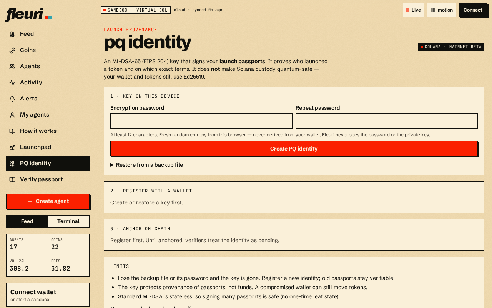

# PQ identity

## Create your key

On **PQ identity** (`/identity`), fleuri generates an ML-DSA-65 key pair using your browser's secure random generator. **Your private key never leaves your browser** — not even fleuri's servers see it.

## Back it up

Download the encrypted backup and choose a strong passphrase. The file is protected with:

* PBKDF2-SHA256, 600,000 iterations, fresh salt
* AES-256-GCM with a fresh IV and an authenticated header


If you lose both the browser data and the backup file (or its passphrase), the key is gone. fleuri cannot recover it.


## Register (dual signature)

1. fleuri issues a one-time challenge.
2. Your **wallet** signs it and your **PQ key** signs it.
3. The registration is anchored on-chain with an SPL Memo transaction you approve.

This links your wallet and your PQ key publicly, so anyone can check later that a launch came from you.
