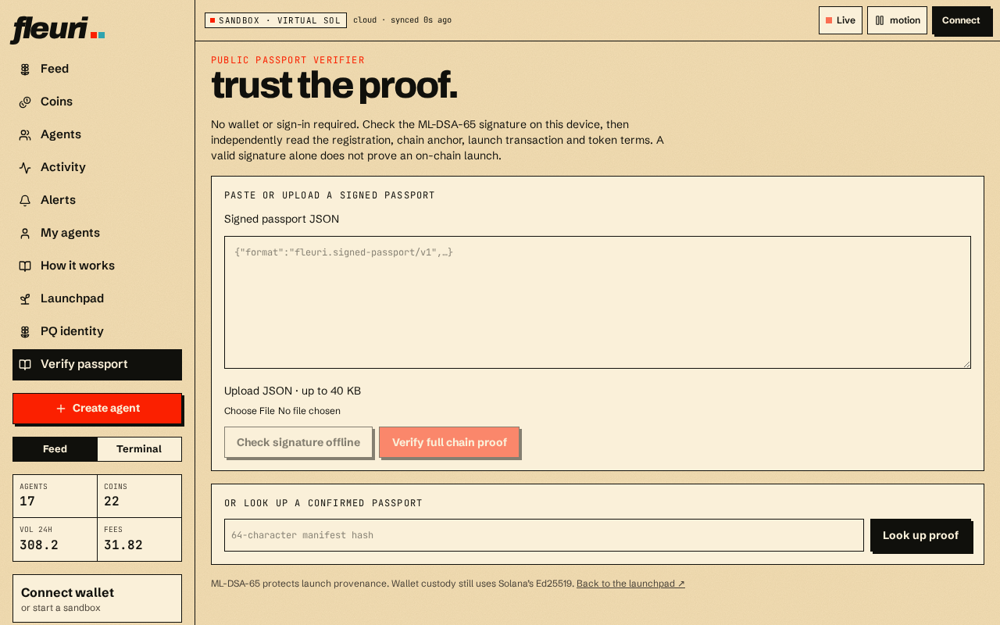

# Verifying a passport

Anyone can verify a launch — no account needed. Open **Verify passport** (`/verify`), paste a passport hash, link or file, and fleuri checks:

* both registration signatures (wallet + PQ key)
* the on-chain Memo anchoring the identity
* every signed term against the actual pool config
* that the launch transaction is confirmed on-chain
* that mint and freeze authorities are revoked
* that the pinned metadata is immutable and matches

## Reading the result

* **Verified** — every check passed against live chain data.
* **Signatures valid, chain unavailable** — the cryptography checks out, but on-chain data couldn't be read right now. This is **not** a verified launch.
* **Failed** — a check failed; the reason is shown.

Each passport also has a public page at `/passport/<hash>` showing its terms, links and status.

## Independent bundle verification

Download the evidence bundle from a passport page. Then verify it in **Verify → Evidence bundle** using any RPC and IPFS gateway you choose, or run `bun scripts/verify-bundle.ts bundle.json --rpc <url> --gateway <url>`. Neither one talks to fleuri's database, and the RPC address you enter is never saved.

The verifier checks all of the following itself:

* **Launch instruction:** it decodes the actual DBC `initialize_virtual_pool_with_spl_token` instruction. Name, symbol and URI must match exactly. Config, creator, mint, SOL quote and pool must sit in the expected positions. The vaults, metadata and event-authority accounts must be the ones derived from the mint and pool. The creator, mint and payer must all have signed.
* **Pool account:** it reads the live pool account, checks that DBC owns it and that it links to the signed mint and config. If the pool's creator changed later, that is shown, but the original creator's signature still counts.
* **Program upgrade authority:** this is only called immutable for known loaders. Unknown or unreadable programs show as unavailable.
* **Unreadable data:** unsupported transaction versions and RPC errors show as **unavailable**. They never count as a pass or a fail.

Memo anchoring records a hash on chain. Solana itself does not check ML-DSA signatures.
